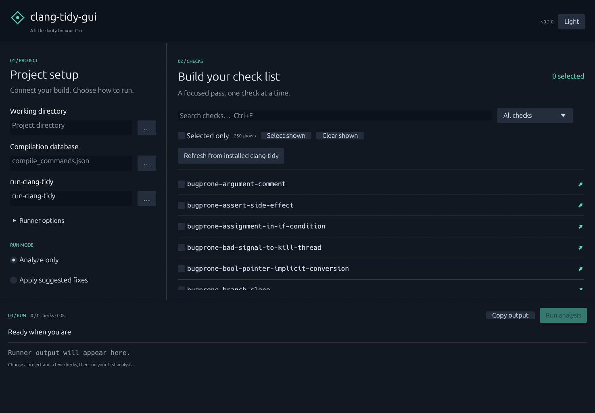
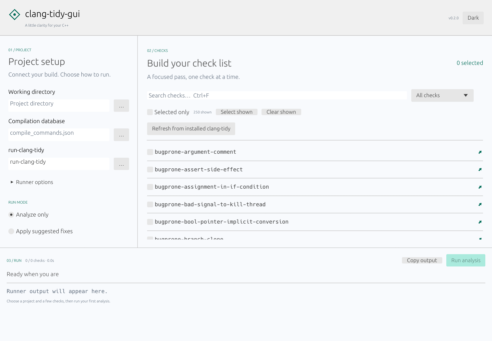

# clang-tidy-gui

**A little clarity for your C++.**

A small desktop workspace for [clang-tidy](https://clang.llvm.org/extra/clang-tidy/).
Choose checks, run them one at a time, and follow the diagnostics without building a command line by hand.

[](https://github.com/varnholt/clang-tidy-gui/actions/workflows/ci.yml)
[](https://www.rust-lang.org/)
[](LICENSE)



<details>
<summary>Prefer a light workspace?</summary>



</details>

## Why a GUI?

clang-tidy has hundreds of useful checks. Applying them all at once can leave an overwhelming diff.
This app lets you build a focused list and run a separate pass for each check.

- **Inspect first.** Analysis is the default; applying fixes is an explicit choice.
- **Keep project settings.** Check selection is passed on the command line. Your `.clang-tidy` stays intact.
- **Use your LLVM.** The check catalogue updates automatically from your installed clang-tidy, with matching selections preserved.
- **See what happened.** Live stdout and stderr, progress, elapsed time, exit failures, and copyable output.
- **Stay in control.** Stop the queue after the active check finishes. A new run starts with a fresh stop state.
- **Make it comfortable.** Search, check families, selection within the current view, resizable panels, and dark or light appearance.

The app wraps LLVM's `run-clang-tidy` Python script. It does not bundle LLVM or replace your build system.

## Install

Install with Cargo:

```sh
cargo install clang-tidy-gui --locked
clang-tidy-gui
```

Prebuilt binaries are available from [GitHub Releases](https://github.com/varnholt/clang-tidy-gui/releases).
Python and LLVM are still required when using a prebuilt binary.

To build from source:

```sh
git clone https://github.com/varnholt/clang-tidy-gui.git
cd clang-tidy-gui
cargo install --path . --locked
clang-tidy-gui
```

You need **Rust 1.88 or newer** to build. Windows, macOS, and Linux are CI targets.
Linux builds also need development packages for the desktop backend. On Ubuntu:

```sh
sudo apt-get install build-essential pkg-config libx11-dev libxi-dev libxrandr-dev libxcursor-dev libxinerama-dev libxkbcommon-dev libwayland-dev libgl1-mesa-dev
```

A graphical desktop and OpenGL support are required at runtime. Linux file dialogs use the desktop's XDG portal.

### LLVM prerequisites

Install **Python 3**, **clang-tidy**, and LLVM's **run-clang-tidy** script.
For applying fixes, also put **clang-apply-replacements** on `PATH`.
The runner may be named `run-clang-tidy` or `run-clang-tidy.py`, depending on the LLVM distribution.

The app accepts a runner path or a name on `PATH`. Python defaults to `python` on Windows and `python3` elsewhere.
Under **Runner options**, point to a different Python or clang-tidy executable if needed.
Use tools from the same LLVM installation. A system Python capable of running that LLVM script is required.

## First run

1. Choose the project's **working directory**.
2. Select the actual **compile_commands.json** file from your build.
3. Locate **run-clang-tidy**. Checks load automatically from the configured clang-tidy executable; change its path under **Runner options** if needed.
4. Search for a few checks, such as `modernize-use-nullptr`, and select them.
5. Choose **Run analysis** and inspect the output. Enable **Apply suggested fixes** when you are ready to edit source files.

Checks execute sequentially and stop at the first nonzero exit status.
The worker count controls parallelism *within* a check; its default is one to avoid concurrent edits to shared headers.
**Stop after this check** waits for the active runner to exit; it does not interrupt file writes.
Keep the app open until the run finishes.

The file filter is a **Python regular expression** matched by LLVM's script against paths in the compilation database.
The default `.*` includes every entry in that database; choosing a working directory does not restrict the file set.
Existing project settings, including warning policies and check options, still apply.
A successful run means the runner exited successfully, not that every warning has an automatic fix.

| Shortcut | Action |
| --- | --- |
| Ctrl+F / Cmd+F | Focus check search |
| Ctrl+Enter / Cmd+Enter | Start the selected run |
| Escape | Stop after the active check |

### Export a compilation database

With CMake, use a Ninja or Makefiles generator:

```sh
cmake -S /path/to/project -B /path/to/project/build -G Ninja -DCMAKE_EXPORT_COMPILE_COMMANDS=ON
```

Then select `build/compile_commands.json`. CMake's Visual Studio and Xcode generators do not export this database.
See [CMake's documentation](https://cmake.org/cmake/help/latest/variable/CMAKE_EXPORT_COMPILE_COMMANDS.html) for details.

There is a tiny [C++ example](examples/cpp) for trying the workflow:

```sh
cmake -S examples/cpp -B examples/cpp/build -G Ninja -DCMAKE_EXPORT_COMPILE_COMMANDS=ON
cargo run --locked
```

Use `examples/cpp` as the working directory, its build database, and the `modernize-use-nullptr` check.
Analysis leaves the example unchanged; applying fixes replaces its null pointer literals with `nullptr`.

## Settings

Paths, run options, and selections are saved automatically in the user configuration directory:

| Platform | Location |
| --- | --- |
| Windows | `%APPDATA%\varnholt\clang-tidy-gui\config\config.json` |
| macOS | `~/Library/Application Support/clang-tidy-gui/config.json` |
| Linux | `$XDG_CONFIG_HOME/clang-tidy-gui/config.json`, usually `~/.config/clang-tidy-gui/config.json` |

The full path is available by hovering over the settings note in the app.
An old `config.json` in the launch directory is imported if no user settings exist.
Malformed settings are reported and left untouched; saving is disabled for that session until the file is repaired or moved.
The bundled starter catalogue is embedded in the executable, so an installed binary works outside a checkout.
It is a historical subset of 250 checks last updated in July 2024; it is not a current or complete LLVM check list.
On every launch, the app discovers checks from the configured clang-tidy in the background.
It refreshes again after you change the executable path, waiting for a short pause in typing.
Successful discovery replaces the catalogue, keeps matching selections, and saves the result.
Discovery has a ten-second timeout. If it fails, the previous catalogue stays available, with its source and refresh failure shown above the list.
Use **Refresh checks now** to retry or pick up an LLVM upgrade made while the app is open.
The app does not download checks from the internet or update LLVM itself: its list follows the installed toolchain.
Only the last 2,000 output chunks are retained; copy the output before starting another run.

## Development

```sh
cargo fmt --check
cargo clippy --all-targets --all-features --locked -- -D warnings
cargo test --locked
cargo package --locked
```

See [CONTRIBUTING.md](CONTRIBUTING.md) for the real LLVM smoke test, screenshots, and release checks.
Changes are recorded in [CHANGELOG.md](CHANGELOG.md).

## License

[CC0 1.0 Universal](LICENSE).
